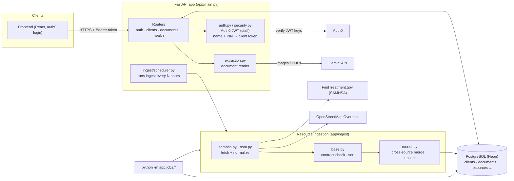

# SecondChance backend

FastAPI + async SQLAlchemy on PostgreSQL (Neon). It lets case workers build client profiles from
uploaded documents, lets clients log in with a name and PIN, and keeps a directory of community
resources (shelters, food, treatment programs) filled from public data sources.

## Architecture



The API and the ingest share one database. Resources are written only by the ingest (or later by
case workers); the API does not expose a resources route yet.

## Folder map

| Path | What it does |
|---|---|
| `app/main.py` | App setup: CORS, error handler, routers, and the optional ingest timer. |
| `app/config.py` | Settings read from `backend/.env`. Only `DATABASE_URL` is required. |
| `app/db.py` | Async engine and `get_session` dependency. |
| `app/tables.py` | All SQLAlchemy models and enums (staff, clients, documents, resources). |
| `app/schemas.py` | Pydantic/dataclass shapes for requests, responses and ingested resources. |
| `app/auth.py`, `app/security.py` | Staff auth (Auth0 JWT) and client auth (PIN hashing, client tokens). |
| `app/extraction.py` | Reads uploaded documents with Gemini and returns a draft client profile. |
| `app/routers/` | HTTP endpoints. |
| `app/ingest/` | Resource ingestion pipeline. See [app/ingest/README.md](app/ingest/README.md). |
| `app/jobs/` | Commands run by hand or a scheduler. |
| `alembic/` | Database migrations. |
| `test_docs/` | Sample documents and `expected_extractions.json` for checking the reader. |

## Main flows

**Case worker adds a client**
1. `POST /clients/extract` with up to 10 PDFs/images (10 MB each). Files are saved unattached and sent to Gemini.
2. The response is a draft profile (IDs, benefits, medications, obligations, contacts). Nothing is created yet.
3. The case worker reviews it and calls `POST /clients`, which creates the client and links the files.
4. `POST /clients/{id}/confirm-all` marks every unverified row as verified by that worker.

**Client logs in**
`POST /auth/client/login` with first name, last name and PIN. The PIN is HMAC'd with a server-side
pepper and hashed with argon2. Wrong PINs count toward a temporary lockout, and a short-lived token
is returned. `GET /auth/client/me` and `/auth/client/documents` use it.

**Staff auth**
Staff sign in through Auth0; the API verifies the access token against Auth0's keys and looks up the
staff record (`/auth/signup`, `/auth/signin`, `/auth/me`). Case workers only see clients assigned to them.

**Resource ingest**
Sources are fetched, normalized to one shape, checked, merged across sources and upserted. A scrape
never erases a good value and never overwrites a case-worker-verified one.

## Endpoints

| Method | Path | Who |
|---|---|---|
| GET | `/health` | anyone |
| POST | `/auth/signup`, `/auth/signin`; GET `/auth/me` | staff |
| POST | `/auth/client/login`; GET `/auth/client/me`, `/auth/client/documents` | client |
| GET | `/clients`, `/clients/{id}` | staff |
| POST | `/clients/extract`, `/clients`, `/clients/{id}/confirm-all` | staff |
| GET | `/documents/{id}/content` | staff / owning client |

Interactive docs are at `/docs` when the server is running.

## Setup

```
python -m venv .venv && .venv\Scripts\activate      # Windows
pip install -r requirements.txt
copy .env.example .env                                # fill in DATABASE_URL and keys
alembic upgrade head
uvicorn app.main:app --reload --port 3000
```

Key settings (see `.env.example` for the full list):

| Variable | Purpose |
|---|---|
| `DATABASE_URL` | PostgreSQL connection string (required). |
| `GEMINI_API_KEY`, `GEMINI_MODEL` | Document reading. |
| `SESSION_SECRET`, `PIN_PEPPER`, `DATA_ENCRYPTION_KEY` | Change from the defaults in any real deployment. |
| `INGEST_ENABLED`, `INGEST_INTERVAL_HOURS` | Run the resource ingest inside the API on a timer (off by default). |

## Jobs

```
python -m app.jobs.ingest_resources [--source samhsa|osm] [--dry-run] [--samples N]
python -m app.jobs.cleanup_documents [--hours N] [--dry-run]
```

## Migrations

```
alembic upgrade head                           # apply
alembic revision --autogenerate -m "message"   # after changing app/tables.py
```

## Notes

- Documents are stored in Postgres (`documents.content`), not on disk.
- Neon suspends idle databases, so the engine pings connections before use and recycles them every 5 minutes.
- No automated test suite yet; `test_docs/` is for checking the document reader by hand.
